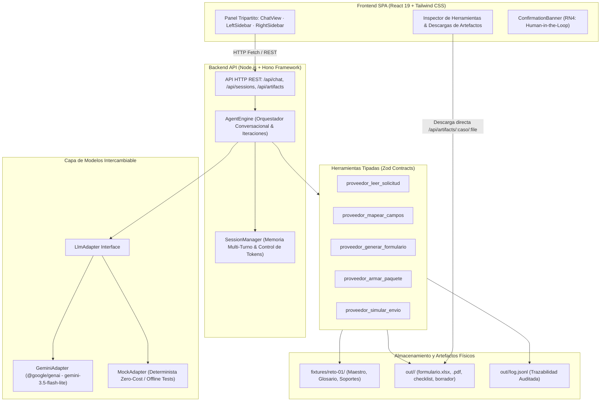

# SOLUCION.md — Arquitectura, Decisiones y Evaluación Técnica
## PRD-01: Registro como Proveedor
### Periferia IT Group S.A.S. · Reto Técnico Perxia 2.0

---

## 1. Definición del Problema en una Frase

> **"El diligenciamiento manual, fragmentado y repetitivo de formularios de registro de proveedores en diversos formatos (Excel, PDF y portales web) para clientes en múltiples países consume horas críticas del equipo administrativo de Periferia IT Group, exponiendo a la empresa a errores fiscales transfronterizos, fuga de datos confidenciales y rechazos por soportes legales vencidos."**

### A quién le duele:
- **Al Analista Administrativo:** Quien debe revisar manualmente los correos de solicitud, transcribir datos corporativos celda por celda o campo por campo, verificar vigencias en PDFs escaneados y armar carpetas de anexos.
- **Al Líder Comercial y Finanzas:** Quienes sufren retrasos en la homologación como proveedores, postergando la facturación, los desembolsos de proyectos y la contratación con clientes corporativos clave en Colombia, Ecuador, Honduras y Panamá.
- **Al Oficial de Cumplimiento y Seguridad:** Quien enfrenta el riesgo latente de que cuentas bancarias se remitan por correo ordinario sin cifrado o de que se reporten identificadores tributarios erróneos ante autoridades aduaneras extranjeras.

---

## 2. Arquitectura de la Solución

La solución se concibió bajo una arquitectura **Full-Stack desacoplada, tipada de extremo a extremo con TypeScript estricto**, modular y orientada a herramientas (*Tool-Calling Agent Architecture*).



### Ubicación del Prompt, Conocimiento y Ejecución:
- **Dónde vive el Prompt del Sistema:**
  - Archivo maestro de backend: `agent/prompt.md`.
  - Módulo reutilizable standalone: `modulo/agent.md` (con frontmatter de permisos `edit: deny`, `bash: deny`).
  - Define la identidad del agente, la regla de grounding estricto (CA2), el protocolo ordenado de herramientas y las reglas de negocio RN1 a RN5.
- **Dónde vive el Conocimiento del Proceso:**
  - Repositorio corporativo maestro: `fixtures/reto-01/repositorio/maestro.json` (datos oficiales de Periferia IT Group).
  - Diccionario transfronterizo: `fixtures/reto-01/glosario-campos.json` (38 homologaciones léxicas entre CO, EC, HN, PA).
  - Catálogo de soportes físicos y vigencias: `fixtures/reto-01/repositorio/soportes/index.json`.
  - Habilidad empaquetada: `modulo/skill/registro-proveedor/SKILL.md`.
- **Dónde vive la Ejecución:**
  - Motor de orquestación conversacional: `src/core/agent.ts`.
  - Herramientas deterministas de dominio: `src/tools/proveedor.ts` y servicios especializados (`src/services/`).
  - Servidor HTTP y políticas de seguridad: `src/server.ts`.

---

## 3. Ciclo del Agente y Confirmación Humana

### 3.1 Bucle Conversacional y Function Calling
El agente implementa un bucle conversacional (*agentic loop*) basado en **Function Calling nativo** utilizando el SDK oficial `@google/genai`:
1. El usuario envía una instrucción (ej. *"Procesa el caso ec-corp-andina"*).
2. El `AgentEngine` construye el contexto de la sesión (`Session.messages`), inyecta el `systemPrompt` y las 5 declaraciones de herramientas Zod, e invoca al modelo mediante `llmAdapter.enviar()`.
3. Si el modelo decide invocar herramientas, emite `toolCalls` (incluyendo su `thoughtSignature` de razonamiento interno).
4. El backend valida los argumentos contra los esquemas Zod correspondientes y ejecuta la herramienta.
5. El resultado estructurado se incorpora a la conversación con rol `tool` y se realiza una nueva iteración con el modelo.
6. El ciclo continúa hasta que el modelo emite su respuesta final de síntesis o se alcanza el límite de iteraciones.

### 3.2 Protección contra Costos y Bucles Infinitos
- **Tope de Iteraciones por Turno:** Configurable mediante `MAX_AGENT_ITERATIONS` (por defecto 15). Si un modelo entra en un bucle repetitivo de llamadas a herramientas, el ciclo se interrumpe de forma controlada y responde con un mensaje de protección de costos sin degradar el servidor.
- **Control de Tokens por Sesión:** Cada llamada al modelo acumula tokens de entrada y salida (`session.totalTokens`). La API expone el consumo en cada respuesta para monitoreo en tiempo real.

### 3.3 Confirmación Humana Estricta en Dos Fases (Human-in-the-Loop - RN4)
Ningún envío o simulación de despacho se ejecuta de forma autónoma. Se implementó una política de **defensa en profundidad**:
1. **Fase 1 (Generación de Token):** Cuando la herramienta `proveedor_armar_paquete` concluye, si y solo si el paquete está verificado como apto (`listo_para_firma = true`), la sesión genera un token de confirmación criptográfico con expiración de 15 minutos:
   ```typescript
   session.createPendingConfirmation(caso, "simular_envio");
   ```
2. **Fase 2 (Ratificación Explícita):**
   - El frontend presenta el componente `ConfirmationBanner` asociado exclusivamente al `sessionId` y al caso activo en pantalla.
   - El analista debe hacer clic explícito en el botón de autorización o responder en el chat una confirmación formal.
   - La API valida en `POST /api/sessions/:id/confirm` que el token sea vigente, coincida con el caso y corresponda a la sesión activa.
3. **Barrera Infranqueable para Paquetes Bloqueados:**
   - Si un paquete tiene `listo_para_firma = false` (debido a soportes vencidos o ausentes según la regla RN3):
     - **En Frontend:** El banner conmuta a modo de alerta de bloqueo (*"Autorización Bloqueada: Soportes No Conformes"*), y el botón de simulación se deshabilita operativamente (*"Envío Inhabilitado (Firma Bloqueada)"*).
     - **En Backend:** El endpoint `POST /api/sessions/:id/confirm` inspecciona el archivo `out/<caso>/paquete/checklist.md`. Si detecta `¿Listo para firma?: NO`, rechaza la solicitud con **HTTP 400 Bad Request** y mensaje explicativo, impidiendo cualquier bypass directo por API.
     - **En Herramienta:** La herramienta `proveedor_simular_envio` valida de forma redundante las vigencias antes de escribir `ENVIO-SIMULADO.md`. Si el paquete está bloqueado, aborta con error tipado.

---

## 4. Selección del Modelo y Costos Reales

### 4.1 Proveedor y Modelo Elegido
- **Proveedor:** Google DeepMind / Google Cloud AI.
- **Modelo:** `gemini-3.5-flash-lite` (vía `@google/genai`).

### 4.2 Justificación Técnica
1. **Latencia Excepcional:** `gemini-3.5-flash-lite` ofrece una latencia de primer token y tiempos de inferencia significativamente menores que modelos de la familia Pro o modelos de competidores, permitiendo encadenar múltiples llamadas a herramientas sin frustrar al usuario.
2. **Soporte Nativo de Function Calling & Reasoning:** Soporta declaraciones de herramientas complejas y preserva los metadatos de pensamiento (`thoughtSignature`), lo cual es indispensable para que las llamadas subsiguientes no pierdan el hilo deductivo.
3. **Ventana de Contexto:** Ventana de 1 millón de tokens, lo que garantiza que historiales conversacionales extensos con múltiples documentos no sufran truncamiento.
4. **Relación Calidad/Precio Insuperable:** Es el modelo más económico y eficiente de la generación Gemini 3.5.

### 4.3 Métricas Medidas y Costo Real por Caso Procesado
A partir de la ejecución en vivo multi-turno realizada contra la API de Google Gemini (documentada en Fase 3.1):

| Métrica | Valor Medido en Vivo |
|---|---|
| **Llamadas a Herramientas Encadenadas** | 4 herramientas en un único turno conversacional |
| **Tiempo de Procesamiento E2E** | 62.2 segundos (lectura + mapeo + generación Excel + empaquetado) |
| **Tokens de Entrada (Prompt)** | 15,618 tokens |
| **Tokens de Salida (Completion/Reasoning)** | 1,155 tokens |
| **Tokens Totales Consumidos** | **16,773 tokens** |

#### Cálculo de Costo Económico (Tarifas Estándar Verificadas de Gemini 3.5 Flash-Lite):
- **Tarifa Entrada (Prompt):** \$0.30 USD por 1,000,000 tokens (\$0.00000030 / token).
- **Tarifa Salida (Completion/Reasoning):** \$2.50 USD por 1,000,000 tokens (\$0.00000250 / token).

$$\text{Costo Entrada (Prompt)} = 15,618 \times \$0.00000030 = \$0.0046854 \text{ USD}$$
$$\text{Costo Salida (Completion)} = 1,155 \times \$0.00000250 = \$0.0028875 \text{ USD}$$
$$\mathbf{\text{Costo Estimado Total por Caso}} = \$0.0046854 + \$0.0028875 = \mathbf{\$0.0075729 \text{ USD}}$$

> **Diferenciación entre Costo Estimado e Importe Facturado:**  
> - **Importe Realmente Facturado en Pruebas:** **\$0.00 USD**. La ejecución de validación en vivo documentada en la Fase 3.1 se procesó dentro del *Free Tier / cuota promocional de desarrollo* de Google AI Studio, por lo cual no generó cobro monetario efectivo.  
> - **Costo Comercial Estándar Estimado:** A las tarifas de pago verificadas, procesar una solicitud de registro integral (lectura, mapeo, generación física y empaquetado con checklist) tiene un costo proyectado de **\$0.0075729 USD (~0.76 centavos de dólar por caso)**, lo que representa aproximadamente **\$7.57 USD por cada 1,000 solicitudes tramitadas**.

---

## 5. Diseño de Automatización en Portales Web (Sección 7.4 del PRD)

Para solicitudes que requieren registro en plataformas web propietarias del cliente (como *VendorHub* en el caso `pa-logistica-istmo`), se definió el siguiente diseño arquitectónico:

### 5.1 Estrategia de Automatización y Límites Operativos
- **Descarte de Automatización Headless Directa:** Intentar que el agente controle un navegador web directamente para autenticarse y enviar formularios en producción presenta riesgos inaceptables:
  - **CAPTCHA y Cloudflare/DataDome:** Los portales corporativos modernos implementan desafíos antibot interactivos.
  - **Autenticación Multifactor (MFA/2FA):** Tokens temporales enviados al móvil o autenticador del analista.
  - **Fragilidad de Selectores:** Un cambio cosmético en el DOM del portal quiebra los scripts de RPA tradicionales.
- **Estrategia Recomendada: Asistencia Estructurada y Copia Rápida:**
  - El agente genera un archivo auditable `valores-portal.md`, estructurado con pares clave-valor listos para copiar con un solo clic.
  - Para una integración avanzada, se plantea una **Extensión de Navegador Corporativa (Chrome Extension)** que lee el payload generado por el agente y autocompleta los campos del portal cuando el analista ya se encuentra autenticado.

### 5.2 Gestión de Credenciales y Seguridad
- **Ubicación:** Las credenciales de acceso a portales de clientes **JAMÁS residen en el repositorio, ni en variables de entorno, ni en los prompts del agente, ni en los logs de ejecución**.
- **Almacenamiento Productivo:** Residen en un gestor de secretos empresarial con rotación y control de acceso basado en roles (ej. **AWS Secrets Manager**, **HashiCorp Vault** o **1Password for Teams**).
- **Ingreso:** Exclusivamente el analista humano autenticado tiene autorización para desbloquear las credenciales mediante su propia llave física o SSO corporativo.

### 5.3 Separación de Responsabilidades (Humano vs Agente)
| Actividad | Agente de IA | Analista Humano |
|---|:---:|:---:|
| Lectura de términos y campos exigidos por el portal | ✅ | ❌ |
| Mapeo y validación contra repositorio maestro | ✅ | ❌ |
| Generación de `valores-portal.md` para copia rápida | ✅ | ❌ |
| Armado de paquete y verificación de soportes | ✅ | ❌ |
| Ingreso de credenciales de usuario y contraseña | ❌ | ✅ (Obligatorio) |
| Resolución de CAPTCHAs y desafíos MFA | ❌ | ✅ (Obligatorio) |
| Inspección final visual de los campos en el portal | ❌ | ✅ |
| Clic final en botón "Enviar Registro" | ❌ | ✅ (Obligatorio) |

---

## 6. Decisiones Técnicas y Descartes

A lo largo del proyecto se tomaron decisiones de diseño pragmáticas priorizando la estabilidad, el determinismo y la seguridad:

### Decisión 1: Backend HTTP en Hono sobre Node.js vs Express / Fastify
- **Alternativa descartada:** Express.js tradicional.
- **Por qué se descartó:** Express carece de tipado estricto de rutas nativo, depende de múltiples middlewares legacy (`body-parser`, `cors`), tiene un overhead de inicialización superior y no aprovecha los estándares modernos de Web Fetch (`Request`, `Response`).
- **Por qué se eligió Hono:** Proporciona inferencia TypeScript estricta de parámetros y respuestas, compatibilidad total con estándares web, huella de memoria mínima y un middleware integrado para servir tanto la API REST como la aplicación SPA compilada en un único proceso ligero.

### Decisión 2: Frontend SPA Desacoplado (React 19 + Tailwind) vs SSR (Next.js / Remix)
- **Alternativa descartada:** Next.js con Server Components.
- **Por qué se descartó:** Para un agente conversacional interactivo con tres paneles sincronizados, el Server-Side Rendering añade complejidad de hidratación, empaquetado innecesario y dificulta el manejo reactivo del estado de llamadas a herramientas y descargas en tiempo real.
- **Por qué se eligió React 19 SPA:** Permite compilar a un bundle estático ultra optimizado (`web/dist`), servido sin costo computacional adicional por Hono, manteniendo el estado de la sesión, historial de herramientas y banners de confirmación en el cliente con máxima responsividad visual.

### Decisión 3: Motor Híbrido de Mapeo (Glosario 38 Términos + Normalización) vs Confiar 100% en Prompting Libre
- **Alternativa descartada:** Delegar todo el mapeo de campos al prompt del LLM en cada turno.
- **Por qué se descartó:** Los LLMs presentan variabilidad probabilística: un día mapean `"Razón Social"` correctamente y otro día pueden inventar una abreviatura o asumir un campo no existente. Esto viola directamente el **Criterio de Aceptación CA2 (Cero Alucinación)**.
- **Por qué se eligió el Motor Híbrido:** `MapperService` evalúa deterministamente las etiquetas contra el glosario oficial de 38 términos y las rutas del maestro. Si un campo no existe en el maestro, se etiqueta taxativamente como `faltante` sin importar qué diga el LLM. El agente solo actúa como orquestador, garantizando consistencia absoluta y trazabilidad del origen del dato (`maestro`, `glosario`, `calculado`, o `sugerido`).

### Decisión 4: Generación Binaria Real (.xlsx y .pdf) vs Respuestas Textuales Simuladas
- **Alternativa descartada:** Generar únicamente texto markdown que el usuario deba copiar o simular archivos vacíos.
- **Por qué se descartó:** El PRD exige explícitamente artefactos físicos utilizables por la empresa y el cliente.
- **Por qué se eligió:** Se integraron bibliotecas de bajo nivel (`exceljs`, `pdfkit`) para escribir hojas de cálculo reales con celdas posicionadas según las plantillas del cliente y PDFs tabulares nativos legibles, con endpoints de descarga seguros protegidos contra Path Traversal.

---

## 7. Supuestos y Limitaciones

### 7.1 Supuestos de Interpretación del PRD
1. **Fecha de Referencia y Vigencias:** Se asume la fecha real del sistema al momento de la ejecución. Dado que los fixtures contienen certificados emitidos a mediados de 2026 (Cámara de Comercio vencida el 2026-09-30 y Parafiscales vencidos el 2026-08-31), la solución asume correctamente que a octubre de 2026 los cuatro casos presentan la firma bloqueada, reflejando el comportamiento real de una auditoría legal.
2. **Repositorio Maestro Único:** Se asume que `maestro.json` representa la única fuente fidedigna de datos corporativos. No se consultan fuentes externas ni bases de datos no controladas.
3. **Manejo de Moneda e Idioma:** Se asume que las solicitudes se tramitan en idioma español para los cuatro países contemplados (Colombia, Ecuador, Honduras y Panamá).

### 7.2 Limitaciones Conocidas
1. **Firma Digital Automática:** El sistema prepara el paquete, verifica las vigencias y genera el checklist, pero no firma criptográficamente los PDFs con certificados digitales PKCS#12, dado que este paso requiere la intervención del Representante Legal.
2. **Plantillas No Estructuradas (Escaneos):** La herramienta procesa plantillas JSON/XLSX/PDF estructuradas. Si un cliente envía una imagen escaneada de baja resolución sin capas de texto, se requeriría un pipeline adicional de OCR.
3. **Almacenamiento Volátil de Sesiones:** Las sesiones conversacionales residen en memoria del proceso (`SessionManager`). Para producción a gran escala, se debe conectar a una base de datos distribuida (Redis / PostgreSQL).

---

## 8. Cobertura de Historias de Usuario (HU)

| Historia de Usuario | Criterios de Aceptación | Estado | Evidencia Técnica | Brecha hacia Producción |
|---|---|:---:|---|---|
| **HU-1: Lectura de Solicitudes** | Identifica formato (`xlsx`, `pdf`, `portal`), cliente, país, campos y soportes exigidos. | **HECHO (100%)** | `proveedor_leer_solicitud`, tests unitarios y CLI determinista `demo.ts`. | Integrar lectura directa desde bandeja de correo Microsoft 365 / Gmail API. |
| **HU-2: Mapeo Transfronterizo** | Mapea etiquetas al maestro corporativo y glosario de 38 términos. Aplica RN1 para identificadores extranjeros. Cero alucinación (CA2). | **HECHO (100%)** | `proveedor_mapear_campos`, `MapperService`, trazabilidad de origen y tests de auditoría. | Conectar con catálogo dinámico de ERP (SAP S/4HANA o NetSuite). |
| **HU-3: Generación de Formulario** | Genera `formulario.xlsx` con celdas reales, `formulario.pdf` nativo y `valores-portal.md`. | **HECHO (100%)** | `proveedor_generar_formulario`, `ExcelGenerator`, `PdfGenerator`, descargas HTTP validadas. | Soporte para formularios interactivos AcroForms complejos. |
| **HU-4: Paquete y Vigencias** | Copia soportes a `out/<caso>/paquete/`, genera `checklist.md` con semáforo, `borrador-correo.md` sin datos bancarios (RN2) y veredicto de firma (RN3). | **HECHO (100%)** | `proveedor_armar_paquete`, `SupportService`, `PackageService`, tests de seguridad bancaria. | Integración con servicio de firma electrónica (DocuSign / Adobe Acrobat Sign). |
| **HU-5: Simulación de Envío** | Exige confirmación humana (RN4), verifica elegibilidad de firma, escribe `ENVIO-SIMULADO.md`. | **HECHO (100%)** | `proveedor_simular_envio`, endpoint `/confirm`, `ConfirmationBanner` y tests E2E. | Reemplazar simulación con despacho de correo real vía SMTP autenticado o API Graph. |

---

## 9. Declaración del Uso de Inteligencia Artificial

En cumplimiento con los lineamientos éticos y de transparencia del reto técnico, se detalla el uso de herramientas de inteligencia artificial durante el desarrollo:

### 9.1 Asistentes y Modelos Utilizados
1. **Google Antigravity (Coding Assistant):**
   - **Tareas:** Asistencia en la generación de código TypeScript estricto, estructuración de esquemas Zod, diseño de componentes React 19, refactorización modular, automatización de pruebas con Node.js Test Runner y ejecución de tests E2E mediante Playwright en Google Chrome.
2. **Google Gemini 3.5 Flash-Lite (Modelo Integrado):**
   - **Tareas:** Motor conversacional en vivo del agente para interpretar intenciones, encadenar llamadas a herramientas vía function calling y formular resúmenes estructurados al usuario.
3. **ChatGPT (OpenAI):**
   - **Tareas:** Consulta conceptual sobre patrones de arquitectura de agentes conversacionales y revisión de casos de borde en homologación fiscal transfronteriza.

### 9.2 Propuestas Descartadas y Justificación Técnica
- **Propuesta Descartada 1: Uso de Frameworks Agénticos de Alto Nivel (LangChain / CrewAI):**
  - *Motivo:* Los asistentes sugirieron inicialmente envolver el agente en LangChain. Se descartó rotundamente porque introduce dependencias excesivas, capas opacas de abstracción, problemas de tipado en TypeScript y latencia innecesaria. Se prefirió una arquitectura limpia, transparente y determinista basada directamente en `@google/genai`.
- **Propuesta Descartada 2: Arquitectura de Microservicios:**
  - *Motivo:* Se propuso separar el generador de PDFs y el orquestador en contenedores distintos. Se descartó por sobreingeniería innecesaria que dificultaría el despliegue en un solo comando y encarecería la infraestructura.
- **Propuesta Descartada 3: Autocompletado "Creativo" de Datos Faltantes:**
  - *Motivo:* Modelos sugirieron deducir números de teléfono o identificadores a partir del contexto del correo. Se rechazó e implementó una barrera de código estricta para garantizar el Criterio de Aceptación CA2: todo campo faltante se declara como tal.

---

## 10. Riesgos en Producción y Mitigaciones

| Riesgo Identificado | Impacto | Nivel de Severidad | Estrategia de Mitigación Implementada |
|---|---|:---:|---|
| **Alucinación de datos tributarios o bancarios** | Sanciones legales, multas de la DIAN o rechazos comerciales por datos falsos. | **CRÍTICO** | Grounding estricto (CA2): las herramientas deterministas son la única fuente de datos. Si no existe en el maestro, se reporta como faltante. |
| **Exposición o fuga de datos bancarios confidenciales (RN2)** | Vulnerabilidad financiera o fraude por envío de cuentas en texto plano. | **CRÍTICO** | El generador de borrador de correo sanitiza estrictamente el contenido, prohibiendo la inclusión de cuentas bancarias. Las pruebas automatizadas verifican la ausencia de dígitos de cuenta. |
| **Despacho accidental de paquetes con documentos vencidos** | Daño reputacional y pérdida de licitaciones corporativas. | **ALTO** | Doble barrera de validación: el frontend inhabilita el botón de confirmación y el backend rechaza con HTTP 400 cualquier intento de despacho si el checklist no aprueba la firma (RN3). |
| **Consumo descontrolado de tokens y costos de API** | Sobrecostos en la factura del proveedor de IA por ataques o bucles infinitos. | **MEDIO** | Límite estricto de iteraciones por turno (`MAX_AGENT_ITERATIONS = 15`) y monitoreo de tokens por sesión (`MAX_SESSION_TOKENS`). |
| **Fallas en portales web de clientes por cambios de interfaz** | Bloqueo en la automatización de clientes de portal. | **MEDIO** | Diseño desacoplado (Sección 7.4): no se intenta automatizar directamente el navegador; se entrega una guía estructurada `valores-portal.md` para copia rápida humana asistida. |
| **Ataques de Inyección de Comandos o Path Traversal** | Acceso no autorizado a archivos del servidor. | **ALTO** | Las herramientas no ejecutan comandos de shell (`child_process` prohibido en tools). Los endpoints de artefactos sanitizan estrictamente los nombres de archivos contra ataques de Path Traversal (`../`). |

