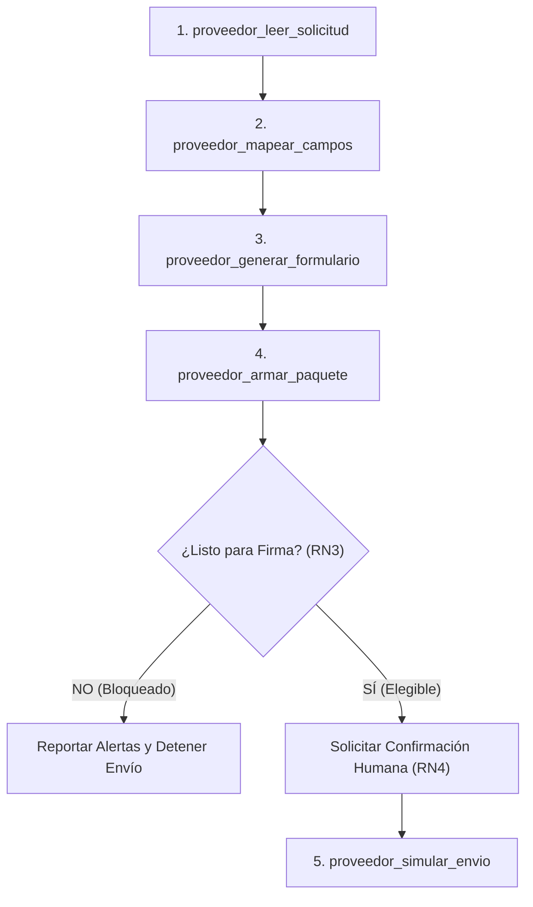

# Habilidad: Registro como Proveedor
## Periferia IT Group S.A.S.

Esta habilidad dota al agente o sistema orquestador del conocimiento de dominio, reglas de negocio y procedimientos operativos necesarios para gestionar autónomamente las solicitudes de registro como proveedor recibidas de clientes corporativos en América Latina.

---

## 1. Perfil de la Empresa Proveedora

Toda información base procede del repositorio maestro corporativo:

| Campo | Valor Oficial |
|---|---|
| **Razón Social** | Periferia IT Group S.A.S. |
| **Identificación Tributaria** | NIT: 900123456-7 |
| **País de Origen** | Colombia (CO) |
| **Ciudad** | Medellín, Antioquia |
| **Dirección** | Carrera 43A # 1-50, Torre Protegida, Of. 801 |
| **Teléfono** | +57 (4) 444-5566 |
| **Representante Legal** | Roberto Andrade Salazar (C.C. 71.234.567) |
| **Actividad Económica** | CIIU 6201 — Actividades de desarrollo de sistemas informáticos |
| **Entidad Bancaria** | Bancolombia |
| **Tipo y Número de Cuenta** | Cuenta Corriente # 123-456789-00 |

---

## 2. Reglas de Negocio Oficiales (RN1 a RN5)

### RN1: Identificadores Tributarios en Clientes Extranjeros
- **Regla:** Cuando un cliente extranjero (Ecuador, Honduras, Panamá) solicita su identificador tributario local (RUC, RTN), la empresa utiliza su NIT colombiano.
- **Acción Obligatoria:** El campo se marca de forma mandatoria como `requiere_confirmacion = true` con la observación `"identificador extranjero; propuesto NIT de Colombia"`.
- **Propósito:** Prevenir errores fiscales y alertar al analista humano sobre la necesidad de acuerdos de doble tributación o cartas aclaratorias.

### RN2: Confidencialidad y Protección de Datos Bancarios
- **Regla:** La información de cuentas bancarias (número de cuenta, banco, tipo de cuenta) está categorizada como información financiera confidencial.
- **Acción Obligatoria:**
  1. Solo se diligencia en el formulario final si la plantilla del cliente lo solicita de forma explícita.
  2. **ESTÁ ESTRICTAMENTE PROHIBIDO** incluir números de cuentas bancarias en el archivo `borrador-correo.md` o en mensajes conversacionales no cifrados.

### RN3: Criterios Deterministas de Bloqueo de Firma
- **Regla:** Un paquete de registro solo es apto para firma legal si la totalidad de soportes exigidos cumplen vigencia.
- **Criterios:**
  - Si un soporte exigido está **ausente** $\rightarrow$ `listo_para_firma = false (BLOQUEADO)`.
  - Si un soporte exigido está **vencido** a la fecha de evaluación $\rightarrow$ `listo_para_firma = false (BLOQUEADO)`.
  - Los campos faltantes en el formulario que no son obligatorios o que provienen de datos opcionales **NO bloquean** la firma, pero deben advertirse en el checklist.

### RN4: Confirmación Humana Estricta en Dos Fases (Human-in-the-Loop)
- **Regla:** Ningún paquete puede ser despachado, enviado ni marcado como tramitado sin autorización humana explícita.
- **Mecanismo:**
  1. Fase 1: El sistema arma el paquete y emite un token de confirmación criptográfico vinculado al `sessionId` y al `caso`.
  2. Fase 2: El analista humano revisa el resumen visual y ratifica la operación.
  3. **Barrera de seguridad adicional:** Si el paquete tiene la firma bloqueada (`listo_para_firma = false`), el sistema inactiva el botón de simulación y el backend rechaza con HTTP 400 cualquier intento forzado de despacho.

### RN5: Grounding Estricto y Trazabilidad de Datos
- **Regla:** El sistema tiene prohibido asumir, autocompletar o alucinar datos empresariales.
- **Mecanismo:** Todo valor debe tener origen trazable (`maestro`, `glosario`, `calculado`, o `sugerido`). Si no existe correspondencia en el glosario de 38 términos ni en el maestro, se declara estrictamente como `campo_faltante`.

---

## 3. Diccionario de Homologaciones y Glosario

El sistema cuenta con un glosario de 38 términos que estandariza las variaciones terminológicas entre países:

| Término Estándar | Colombia | Ecuador | Honduras | Panamá | Origen Maestro |
|---|---|---|---|---|---|
| **Identificación Fiscal** | NIT | RUC (RN1) | RTN (RN1) | RUC (RN1) | `identificacion.nit` |
| **Razón Social** | Razón Social | Nombre Comercial / Razón Social | Nombre de la Empresa | Razón Social | `empresa.razon_social` |
| **Representante Legal** | Rep. Legal | Representante / Apoderado | Gerente / Representante | Representante Legal | `representante.nombre` |
| **Doc. Representante** | Cédula Ciudadanía | Cédula de Identidad | Cédula / Identidad | Cédula / Pasaporte | `representante.documento` |
| **Dirección Principal** | Domicilio Fiscal | Dirección Matriz | Dirección Fiscal | Dirección de Oficina | `ubicacion.direccion` |
| **Correo Notificación** | Correo Electrónico | Email Corporativo | Correo Contacto | Correo Administrativo | `contacto.email` |
| **Certificación Bancaria** | Certificado Bancario | Certificación de Cuenta | Constancia Bancaria | Carta Bancaria | Soportes |
| **Vigencia Comercial** | Cámara de Comercio | Registro Mercantil | Escritura Constitución | Registro Público | Soportes |

---

## 4. Protocolo Operativo de las 5 Herramientas

1. **`proveedor_leer_solicitud`**: Inspecciona el archivo de solicitud (`.json`), identifica formato (`xlsx`, `pdf`, `portal`), cliente, país, campos requeridos y lista de soportes exigidos.
2. **`proveedor_mapear_campos`**: Cruza la lista de etiquetas con el maestro corporativo y el glosario. Clasifica en `llenos`, `faltantes` y `requiere_confirmacion`.
3. **`proveedor_generar_formulario`**:
   - `xlsx`: Genera hoja de cálculo real con openpyxl / ExcelJS con encabezados y valores en celdas correspondientes.
   - `pdf`: Renderiza PDF nativo con PDFKit/PDF-lib, tipografía legible y estructura tabular.
   - `portal`: Genera `valores-portal.md` con formato de copia rápida y advertencia de no automatización directa por seguridad.
4. **`proveedor_armar_paquete`**: Copia soportes existentes a `out/<caso>/paquete/`, genera `checklist.md` con semáforo de vigencias y redacta `borrador-correo.md` sin datos bancarios.
5. **`proveedor_simular_envio`**: Solo ejecutable tras confirmación humana y verificación de paquete elegible. Escribe `ENVIO-SIMULADO.md`.

